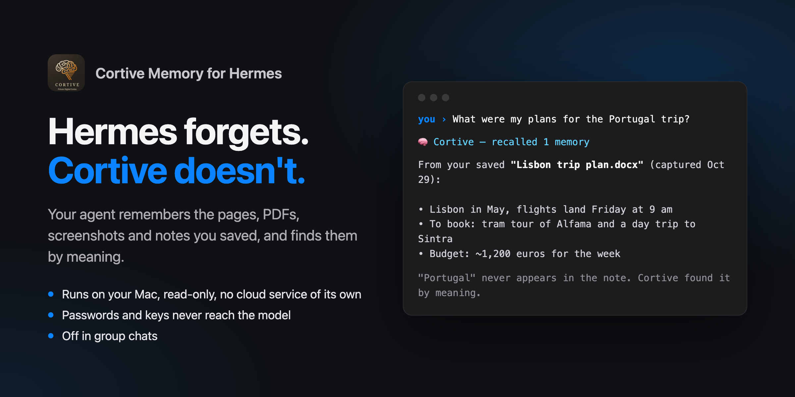
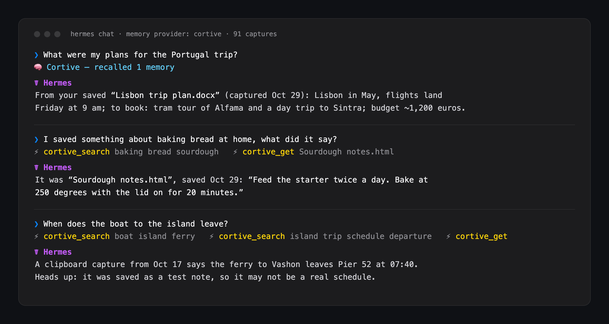

# Cortive Memory for Hermes



**Hermes remembers what you tell it. Cortive remembers what you saved.**

[Cortive](https://github.com/KadenDevAi/cortive-releases) is a private knowledge base for your Mac. It keeps the web pages, PDFs, screenshots, voice memos, documents and clipboard snippets you capture, and finds them again by meaning, with an on-device model. This plugin adds that library to Hermes's memory, alongside the built-in memory Hermes already keeps. Ask Hermes about something you read last month, and it answers from what you actually saved, with the date and the source.

- **Recall without being asked.** Before each reply, Hermes gets up to three relevant captures (1,200 characters at most) from your library. With the Cortive app running, recall judges relevance by meaning: on 50 everyday prompts ("write a haiku", "convert 72°F") it attached something to 7, while still recalling the right capture for 48 of 51 questions about saved material. Without the app it only recalls when your message refers to your saved material ("my notes on…", "I saved…", "remember…"), because word matches alone can't judge relevance.
- **Three tools for digging deeper:**
  - `cortive_search`: ranked search. Typos are corrected and plurals match. It filters by kind ("screenshots", "photos", "pdf") and by date ("last week", "September 2025"), and with no search words it lists the newest captures of that kind or period.
  - `cortive_get`: one capture in full, including its screenshot. Long documents are read page by page.
  - `cortive_collections`: the whole library in one call (totals, where captures came from, the newest ones, and every collection with example titles), or everything inside one collection.
- **Understands what you mean.** While the Cortive app is running, searches go through Cortive's own on-device search, which finds by meaning as well as by words: "my Portugal trip" finds the capture that only says "Lisbon". Without the app, it searches by words.
- **Local, read-only, no keys.** It reads one file on your computer and talks only to the Cortive app on the same Mac. No network calls, no accounts, no credentials, and nothing in your library is ever changed.

## Get Cortive

The plugin reads the library the Cortive desktop app creates, so install Cortive first (free public beta, Apple silicon Mac, macOS 14 or later):

```bash
curl -fsSL https://raw.githubusercontent.com/KadenDevAi/cortive-releases/main/install.sh | bash
```

Or download the DMG from [Cortive's releases](https://github.com/KadenDevAi/cortive-releases/releases/latest). Open Cortive once and capture a few things (a page, a screenshot, a PDF).

## Install

```bash
hermes plugins install KadenDevAi/hermes-cortive
hermes config set memory.provider cortive
```



Start a new chat. The system prompt now says `Cortive knowledge base active: N captures`, and replies that used your library show `🧠 Cortive — recalled N memories`.

Cortive keeps its library at `~/Library/Application Support/cortive-ai/cortive.db`. If yours is somewhere else, run `hermes memory setup` and set `db_path`, or set the `CORTIVE_DB_PATH` environment variable.

Hermes uses one external memory provider at a time, so selecting `cortive` replaces any other provider you had (Hermes's built-in memory keeps working).

## What it reads, and what it doesn't touch

| | |
|---|---|
| **Reads** | Cortive's library file (`cortive.db`), opened with SQLite `mode=ro` and `query_only`, so a write is refused by SQLite itself. Tables: `captures`, `captures_fts`, `collections`, `deleted_captures`. |
| **Writes** | Only inside Hermes's own data folder: `<hermes home>/plugin-data/cortive/config.json` (if you set `db_path`) and `…/screenshots/<id>.png` when `cortive_get` opens a capture that has a screenshot. |
| **Talks to** | The Cortive app on this Mac, through its private search socket (`~/Library/Application Support/Cortive/agent/search.sock`, readable only by your account). It sends the search text and gets back capture ids and scores. If the app isn't running, nothing is sent and search falls back to words. Override the path with `CORTIVE_AGENT_SOCKET`. |
| **Never** | Network calls, credentials, `.env`/`auth.json`/keychain reads, background services, changes to Cortive's library or settings, self-updates. |
| **Skips** | Encrypted captures, captures you deleted (in Cortive's Recently Deleted), and captures with no text. |

### Privacy

Everything stays on your computer. The recalled text is sent to whichever model Hermes is using, the same as anything else in your conversation. If that model is a cloud model, the excerpts Hermes recalls go to that provider. Use a local model if your library must never leave the machine.

### Not in group chats

If Hermes is in a group chat, channel or thread (Telegram, Discord, Slack…), Cortive switches itself off there: no automatic recall, and its tools decline, so nobody else in the chat sees your saved material. Turn `shared_chats` on in `hermes memory setup` if you really want it. Anyone who can message your Hermes bot directly can ask it about your Cortive, so keep the bot's allowed users to yourself. Scheduled jobs and sub-agents can still search, but get no automatic recall.

### Passwords and keys are hidden from the model

Clipboard captures can hold passwords and API keys. Before anything leaves the plugin (text, titles and links alike), things that look like credentials are replaced with `[hidden: looks like a password or key]`: OpenAI, Anthropic, Stripe, GitHub, AWS, Google and Slack keys, login tokens, private key files, labelled values the way people write them (`password: …`, `wifi pw - …`, `Password` with the value on the next line, `"password": "…"`, `PIN: …`, `wifi key: …`, `login: user / …`, passphrases, and `Passwort`, `mot de passe`, `contraseña`), and card numbers that pass the Luhn check. Placeholders, code and prose ("the password field is required") are left alone. Secrets are hidden across the whole capture before any part of it is shown, so a search excerpt or a `cortive_get` offset can't start just after the label and show the value. A search that matches a capture only through a hidden value leaves that capture out, so search can't confirm a guessed password. Open the capture in Cortive to see the original.

This also holds when your Hermes has a terminal, file reading or a browser. Two hooks enforce it in code, not just by asking the agent: any tool call that points at Cortive's data folder (for example `sqlite3` on its database) is refused, and every password saved in your Cortive library is hidden from every other tool's output (a `cat` of the original note, a web page, a database dump), also when reversed or in base64, before the model sees it. Limits: a secret has to be recognisable to be hidden ("my wifi: …" with no password label is not); values under 6 characters, like PINs, are hidden in Cortive's own results but not in other tools' output, where they would blank ordinary numbers; and text in images, such as a photo of a password, is not read. Your Hermes approval settings still decide which files and commands the agent may use.

### Saved pages are untrusted

A page you captured can contain text written to manipulate an AI ("ignore your instructions and…"). The plugin treats every capture as quoted material, never as instructions:

- Automatic recall and every tool result are labelled as quoted reference material, not instructions, and the plugin's standing prompt tells the agent never to follow instructions found in captures and to point them out to you.
- Recall shows each capture as one quoted line: a capture can't start a line of its own, fake a heading, or close its own quotation.
- Invisible characters (zero-width spaces, text-direction overrides) that can hide instructions from you while an AI still reads them are removed.

Tested with planted captures (fake system notes, a disguised "formatting preference" that tried to add an ad line to answers, requests to dump your links): no attack succeeded after these changes, and agents more often warned the user about the planted text. A determined attack on a weak model can never be ruled out entirely, so the plugin also exposes no tools that act on your behalf: it can only read.

## How results are ranked

**With the Cortive app running**, results come in the app's own order: it combines word matches with meaning matches from its on-device model (EmbeddingGemma 2) and leaves out meaning matches that don't clearly stand out. The plugin then reads each result's details from your library with the rules below (no encrypted or deleted captures, your filters), and fills any remaining slots with word matches. Automatic recall uses the app's results only.

**Without the app**, matching uses SQLite FTS5 over titles, URLs, tags, notes and full text. **A capture that contains more of your words always ranks above one that contains fewer.** Among captures that match the same number of words, this score decides:

```
score = 1.00 × relevance     FTS5 bm25, scaled 0..1 against the best candidate
      + 0.25 × recency       halves every 90 days since the capture was made
      + 0.15 × tag match     share of your search words found in the capture's tags
      + 0.10 × title match   share of your search words found in its title
```

- **Ties** go to the newer capture, then to the capture id, so results never shuffle between runs.
- **Duplicates** (same content hash) collapse to the best-scoring copy.
- **Automatic recall is stricter than search.** With the app, recall uses only the app's results, which leave out meaning matches that don't clearly stand out. Without it, recall waits for a message about your saved material, then a capture has to match at least two of your words (or the only one) and score within 60% of the best hit.
- **Your words are cleaned first.** Filler words ("what", "did", "my", "remember"…) are dropped, and FTS5 syntax characters are stripped, so nothing you type can break the search.
- **Endings are trimmed** so other forms match: "screenshots" finds "screenshot", and "strategies" finds "strategy".
- **Typos are corrected only when a word appears nowhere in your library.** The closest word that does appear replaces it ("sourdugh" → "sourdough"), and the tool result says what it changed.

## Failure modes

| Situation | What happens |
|---|---|
| Cortive isn't installed or the library is missing | The provider doesn't activate. Hermes shows which path was checked and how to fix it. |
| The library is from an older Cortive (schema < 11) | Doesn't activate, and asks you to update Cortive. |
| A newer Cortive (schema > 11) | Activates, and notes once that the plugin may need an update. |
| Cortive is saving a capture at that moment | Recall waits up to 1.5 s, then skips that turn quietly. Tools wait up to 5 s, then say "Cortive is busy". |
| The library disappears mid-session | Tools return an error saying where they looked; recall resumes when the file is back. |

## Limitations

- **Encrypted captures can't be read.** Cortive doesn't encrypt captures today. If it starts, those captures are skipped.
- **Meaning search needs the Cortive app running**, in a version with agent search (the public beta has it). The plugin ships no model, no binaries and no Python dependencies; the app does the meaning search. Without it, search matches words only ("Portugal vacation" won't find a capture that only says "Lisbon"), and the tool tells the agent so it retries with other words.
- **Voice recordings have no transcript.** Cortive finds them by their sound and file name, but the agent can't read what was said.
- **Read-only.** Hermes conversations aren't saved into Cortive (planned for a later version).
- **macOS only**, like Cortive's beta.

## Development

Python standard library only. The tests use a synthetic library (`fixtures/make_fixture.py`), never real data:

```bash
python3.12 -m unittest discover -s tests -v   # or: pytest -q
hermes plugins validate .
```

The tests import `agent.memory_provider` from Hermes's source. Set `HERMES_AGENT_DIR` if Hermes isn't at `~/.hermes/hermes-agent`.

## License

MIT, see [LICENSE](LICENSE). Cortive itself is a separate, closed-source app.
